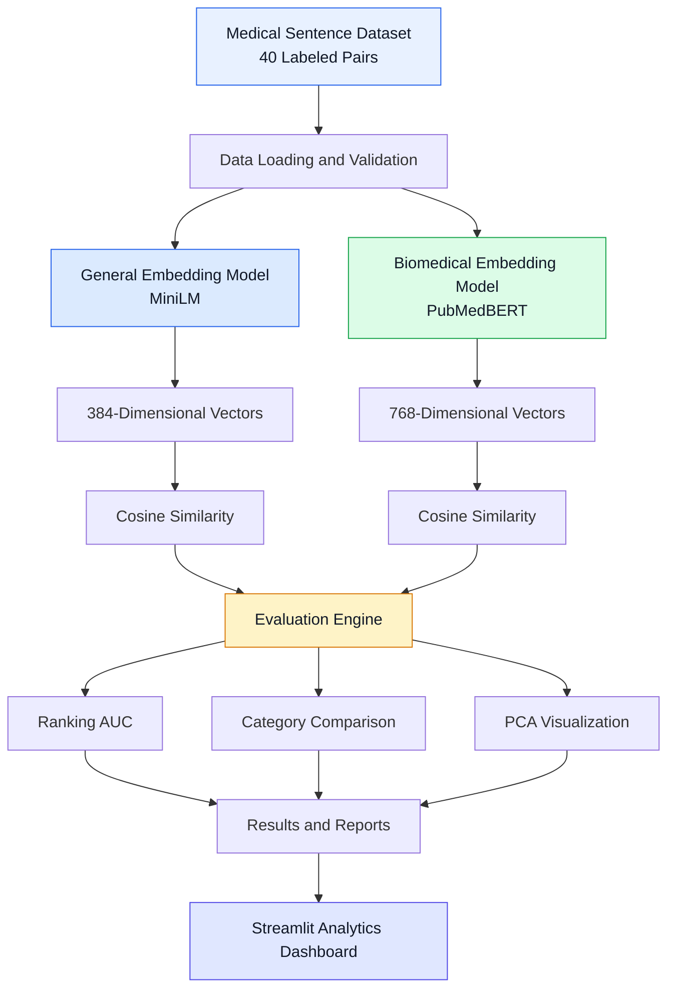

<div align="center">

# Medical Text Embedding Model Comparison

### A Comparative Study of General-Purpose and Biomedical Sentence Embeddings

**Evaluating semantic understanding of medical text using transformer models, cosine similarity, and PCA visualization.**

[](https://www.python.org/)
[](https://huggingface.co/)
[](https://streamlit.io/)
[](https://scikit-learn.org/)


**[Overview]
• [Architecture](#-system-architecture)
• [Installation](#-installation-and-setup) 
• [Evaluation](#-evaluation-methodology) 
• [Dashboard](#-interactive-dashboard) 
• [Results](#-generated-outputs)**

</div>


##  Project Overview

Text embeddings are an important part of Natural Language Processing (NLP). They convert text into numerical vectors so that machine learning models can process and compare the meaning of sentences.

However, general-purpose language models and domain-specific models may understand medical terminology differently.

This project investigates how effectively two pretrained embedding models represent medical sentences:

1. **General-purpose model:** all-MiniLM-L6-v2
2. **Biomedical model:** PubMedBERT Embeddings

The experiment compares these models using **40 synthetic medical sentence pairs**, covering medical synonyms, abbreviations, negation, and numerical differences.

The primary objective is to understand which model better distinguishes semantically equivalent statements from statements with different clinical meanings.

An interactive Streamlit dashboard is provided for exploring the generated results.

### Key Objectives

- Convert medical sentences into dense numerical vectors.
- Compare general-purpose and biomedical embedding models.
- Evaluate 40 labeled medical sentence pairs.
- Measure semantic similarity using cosine similarity.
- Analyze model performance using ranking AUC.
- Compare results across four medical language categories.
- Visualize sentence embeddings using Principal Component Analysis (PCA).
- Explore actual experiment results through an interactive dashboard.
- Generate reproducible outputs and comparison reports.


##  Embedding Models

Two pretrained transformer models are used in this experiment.

| Feature | General-Purpose Model | Biomedical Model |
|---|---|---|
| Model | all-MiniLM-L6-v2 | PubMedBERT Embeddings |
| Hugging Face ID | `sentence-transformers/all-MiniLM-L6-v2` | `NeuML/pubmedbert-base-embeddings` |
| Dimensions | 384 | 768 |
| Main Focus | General semantic understanding | Biomedical semantic understanding |
| Domain | General English | Biomedical literature |
| Usage | Sentence similarity | Biomedical sentence similarity |

### Model 1: General-Purpose MiniLM

**Hugging Face:** [all-MiniLM-L6-v2](https://huggingface.co/sentence-transformers/all-MiniLM-L6-v2)

MiniLM is a lightweight sentence transformer designed to generate meaningful sentence embeddings.

It produces **384-dimensional numerical vectors** and is widely used for semantic similarity tasks.

**Why it was selected:**

- Lightweight architecture.
- Efficient sentence embedding generation.
- Suitable baseline for general semantic similarity.
- Useful for comparing general language understanding with biomedical language understanding.

### Model 2: Biomedical PubMedBERT

**Hugging Face:** [PubMedBERT Embeddings](https://huggingface.co/NeuML/pubmedbert-base-embeddings)

PubMedBERT Embeddings is a biomedical sentence embedding model fine-tuned using PubMed title and abstract data.

It generates **768-dimensional numerical vectors**.

**Why it was selected:**

- Specialized biomedical text representations.
- Designed for biomedical semantic similarity.
- Relevant to medical terminology and scientific language.
- Useful for evaluating domain-specific embedding performance.

> **Note:** Both models are used as pretrained models. This project does not train them from scratch. Review the individual model licenses before redistributing model weights or using them commercially.


##  System Architecture

The system follows a structured NLP evaluation pipeline.



### Processing Workflow

**Step 1  Data Preparation**

Load and validate the medical sentence pairs and their expected semantic labels.

**Step 2  Embedding Generation**

Generate vector representations for every unique medical sentence using both pretrained models.

**Step 3  Similarity Measurement**

Calculate cosine similarity for each sentence pair separately in each model's embedding space.

**Step 4  Performance Evaluation**

Evaluate the models using ranking AUC and category-specific comparisons.

**Step 5  Dimensionality Reduction**

Apply PCA to project high-dimensional sentence vectors into two dimensions.

**Step 6  Results Visualization**

Present the generated metrics, charts, sentence comparisons, and reports through the Streamlit application.


##  Medical Sentence Dataset

The dataset contains **40 synthetic medical sentence pairs**, distributed equally across four categories.

| Category | Pairs | Gold Label | Evaluation Focus |
|---|---:|---|---|
| Medical Synonyms | 10 | Equivalent | Different expressions with similar meaning |
| Medical Abbreviations | 10 | Equivalent | Medical abbreviations and their full forms |
| Negation | 10 | Non-equivalent | Statements with opposite clinical meaning |
| Numerical Differences | 10 | Non-equivalent | Changes in medical measurements or values |
| **Total** | **40** | **20 positive / 20 negative** | **Semantic comparison** |

### 1. Medical Synonyms

Tests whether models understand medical terms and their equivalent expressions.

**Example:**

- Sentence A: "The patient has hypertension."
- Sentence B: "The patient has high blood pressure."

**Expected:** Semantically equivalent.

### 2. Medical Abbreviations

Tests how effectively models understand commonly used medical abbreviations.

**Example:**

- Sentence A: "The ECG results were normal."
- Sentence B: "The electrocardiogram results were normal."

**Expected:** Semantically equivalent.

### 3. Medical Negation

Tests whether models distinguish clinically contradictory statements.

**Example:**

- Sentence A: "The patient has pneumonia."
- Sentence B: "The patient does not have pneumonia."

**Expected:** Semantically different.

### 4. Numerical Differences

Tests whether models recognize differences in medical measurements.

**Example:**

- Sentence A: "The blood glucose level is 90 mg/dL."
- Sentence B: "The blood glucose level is 350 mg/dL."

**Expected:** Semantically different for the evaluation task.

### Dataset Structure

**File:** `data/medical_sentence_pairs.csv`

Each record includes:

| Column | Description |
|---|---|
| `pair_id` | Unique sentence pair identifier |
| `category` | Medical language category |
| `sentence_1` | First medical sentence |
| `sentence_2` | Second medical sentence |
| `same_meaning` | Binary ground-truth label |
| Clinical rationale | Explanation supporting the label |

All examples are synthetic and do not contain real patient information.

> This is a small educational benchmark. The labels are manually authored and would require medical expert review before use in a clinical research setting.


##  Technologies Used

| Technology | Purpose |
|---|---|
| Python | Core development |
| Sentence Transformers | Sentence embedding generation |
| Hugging Face | Pretrained model access |
| NumPy | Numerical vector operations |
| Pandas | Dataset and results processing |
| Scikit-learn | PCA and performance evaluation |
| Matplotlib | Statistical visualizations |
| Streamlit | Interactive analytics dashboard |
| Pytest | Automated testing |


##  Installation and Setup

### Prerequisites

Make sure the following are available:

- Python 3.11 (64-bit recommended).
- pip package manager.
- Internet connection for the initial model download.
- Sufficient free disk space for dependencies and pretrained models.

A dedicated GPU is optional. The experiment can run using a CPU.

### 1. Clone the Repository

```bash
git clone https://github.com/behra527/medical-embedding-model-comparison.git
```

```bash
cd medical-embedding-model-comparison
```

### 2. Create a Virtual Environment

**Windows PowerShell:**

```powershell
py -3.11 -m venv .venv
```

Activate the environment:

```powershell
.\.venv\Scripts\Activate.ps1
```

**Linux / macOS:**

```bash
python3 -m venv .venv
source .venv/bin/activate
```

### 3. Install Dependencies

Upgrade pip:

```bash
python -m pip install --upgrade pip
```

Install the required libraries:

```bash
python -m pip install -r requirements.txt
```

### 4. Run Automated Tests

```bash
python -m pytest -q
```

Tests validate the dataset, numerical calculations, and evaluation logic without downloading the pretrained model weights.

### 5. Run the Embedding Experiment

```bash
python run_analysis.py --device cpu --batch-size 8
```

The application will:

1. Load the medical dataset.
2. Download pretrained models if necessary.
3. Generate numerical embeddings.
4. Calculate sentence pair similarities.
5. Compute evaluation metrics.
6. Generate PCA visualizations.
7. Save comparison results and reports.

**Note:** Initial model downloads require an internet connection. CPU inference may be slower than GPU inference.

### 6. Launch the Dashboard

```bash
python -m streamlit run app.py
```

Open your browser at:

**http://localhost:8501**

The dashboard reads generated experiment results. It does not populate performance metrics with fabricated values.

### Google Colab / Linux Setup

```bash
python -m pip install -r requirements.txt
python -m pytest -q
python run_analysis.py
```

For GPU-enabled environments, the experiment can use an available compatible accelerator.


##  Evaluation Methodology

### 1. Numerical Sentence Embeddings

Each model converts a text sentence into a numerical vector.

The general-purpose model returns 384-dimensional vectors, while the biomedical model returns 768-dimensional vectors.

Each sentence is encoded independently using the selected pretrained model.

### 2. Cosine Similarity

Cosine similarity measures the angle between two vectors.

$$
\text{Cosine Similarity}(A,B)=
\frac{A\cdot B}{\|A\|\|B\|}
$$

Where:

- **A:** Embedding of sentence 1.
- **B:** Embedding of sentence 2.
- **A · B:** Dot product.
- **||A|| and ||B||:** Vector magnitudes.

A higher cosine value indicates greater similarity in the model's embedding space.

However, high similarity does not necessarily mean that two medical statements are clinically equivalent.

For example, a positive statement and its negation may receive similar embeddings.

**Important:** MiniLM and PubMedBERT vectors belong to different embedding spaces and have different dimensions. Their raw vectors should not be directly compared with one another.

### 3. Ranking AUC

The main evaluation metric is ranking Area Under the ROC Curve (AUC).

Ranking AUC measures how effectively a model ranks semantically equivalent pairs above non-equivalent pairs.

| AUC Value | Interpretation |
|---|---|
| 1.00 | Perfect ranking on the evaluated dataset |
| 0.50 | Chance-like ranking |
| Below 0.50 | Ranking tends to be reversed |

Higher ranking AUC indicates better separation of equivalent and non-equivalent pairs.

The experiment evaluates:

- Overall ranking AUC.
- Category-specific ranking AUC.
- Mean similarity scores.
- Similarity separation gaps.

Unlike raw cosine averages, ranking AUC provides a more appropriate basis for comparing two models with different score distributions.

### 4. Category-Wise Evaluation

The models are evaluated separately for:

- Synonyms.
- Abbreviations.
- Negation.
- Numerical differences.

For each category, its ten labeled pairs are evaluated against the twenty pairs carrying the opposite label.

This makes it possible to compare how each model handles a specific type of medical language challenge.

### 5. Principal Component Analysis

PCA is used to reduce the embedding vectors into two dimensions.


This helps explore how medical sentences are positioned and grouped within each model's embedding space.

PCA is performed separately for each model.

The resulting plots are useful for exploratory visualization, but 2D distances do not directly represent cosine similarity in the original high-dimensional space.


##  Interactive Dashboard

The project includes a Streamlit-based analytics interface for exploring actual generated results.

### Dashboard Modules

#### 1. Overview Dashboard

Provides a high-level summary of the experiment.

Features include:

- Number of evaluated sentence pairs.
- Number of compared models.
- Overall ranking AUC.
- Model comparison summaries.
- Category-level performance charts.

#### 2. Model Comparison

Allows detailed comparison between general-purpose and biomedical models.

Features include:

- Model-wise AUC comparison.
- Cosine similarity distributions.
- Category performance analysis.
- Similarity separation analysis.

#### 3. Sentence Explorer

Allows users to inspect the original medical sentence pairs.

Features include:

- Search functionality.
- Category filtering.
- Similarity score comparison.
- Individual sentence inspection.
- Results export.

#### 4. Visualizations

Displays generated experiment figures.

Includes:

- General-model PCA.
- Biomedical-model PCA.
- Cosine similarity by category.
- Ranking AUC by category.

#### 5. Reports and Exports

Provides access to generated experiment files, numerical embeddings, and analysis reports.

> The dashboard is intended for research exploration and demonstration. It is not a validated clinical decision-support application.


##  Project Structure

```text
medical-embedding-model-comparison/
│
├── app.py
│   # Interactive Streamlit dashboard
│
├── run_analysis.py
│   # Main experiment execution
│
├── metrics.py
│   # Cosine similarity and AUC evaluation
│
├── plots.py
│   # PCA and statistical visualizations
│
├── requirements.txt
│   # Python dependencies
│
├── README.md
│   # Project documentation
│
├── data/
│   └── medical_sentence_pairs.csv
│
├── notebooks/
│   └── medical_embedding_comparison.ipynb
│
├── tests/
│   # Automated tests
│
└── outputs/
    # Created after running the analysis
    │
    ├── text_index.csv
    ├── embeddings_general.npy
    ├── embeddings_biomedical.npy
    ├── embeddings_general.csv
    ├── embeddings_biomedical.csv
    ├── results.csv
    ├── overall_summary.csv
    ├── category_comparison.csv
    ├── analysis_report.md
    │
    └── figures/
        ├── pca_general.png
        ├── pca_biomedical.png
        ├── cosine_by_category.png
        └── auc_by_category.png
```

---

##  Generated Outputs

After the experiment runs successfully, the system produces the following files.

| Output | Description |
|---|---|
| `text_index.csv` | Unique source sentences and identifiers |
| `embeddings_general.npy` | General-model numerical vectors |
| `embeddings_biomedical.npy` | Biomedical-model numerical vectors |
| `embeddings_general.csv` | General embeddings as tabular data |
| `embeddings_biomedical.csv` | Biomedical embeddings as tabular data |
| `results.csv` | Sentence pairs, labels, and cosine scores |
| `overall_summary.csv` | Model-level evaluation metrics |
| `category_comparison.csv` | Category-level performance and winners |
| `analysis_report.md` | Generated research analysis |
| `figures/` | PCA and performance visualizations |

### How the Better Model Is Identified

The final comparison focuses on:

1. Overall ranking AUC.
2. Category-wise ranking AUC.
3. Similarity separation between equivalent and non-equivalent pairs.
4. Exploratory PCA patterns.
5. Individual errors involving negation and numerical differences.

The model achieving higher AUC on a category is considered the better-ranking model for that category on this dataset.

**Experimental results are not hardcoded.** Performance scores and category winners are generated after both models complete inference.

---

##  Testing and Validation

Automated testing is performed using Pytest.

Run:

```bash
python -m pytest -q
```

The test suite checks:

- Medical dataset structure and labels.
- Cosine similarity calculations.
- Rejection of zero-vector inputs.
- Correct handling of ranking ties.
- AUC calculation logic.
- Category winner selection.

These tests verify the supporting evaluation code without requiring pretrained model inference.

Passing unit tests does not independently establish medical accuracy or clinical reliability.

---

##  Additional Commands

Display available experiment options:

```bash
python run_analysis.py --help
```

Run with a custom dataset and output location:

```bash
python run_analysis.py \
  --dataset data/medical_sentence_pairs.csv \
  --output outputs \
  --batch-size 4 \
  --device cpu
```

**Windows PowerShell (single line):**

```powershell
python run_analysis.py --dataset data/medical_sentence_pairs.csv --output outputs --batch-size 4 --device cpu
```

### Common Installation Issues

**Streamlit command not recognized**

Use:

```powershell
python -m streamlit run app.py
```

**NumPy compilation error**

Use a compatible 64-bit Python environment. Python 3.11 is recommended for this project.

Check installed versions:

```powershell
py -0p
```

Create the environment explicitly using Python 3.11:

```powershell
py -3.11 -m venv .venv
```

**Model download failure**

Confirm the internet connection and that Hugging Face model repositories are accessible.

**Dashboard has no results**

Run:

```powershell
python run_analysis.py
```

Then refresh the dashboard.

---

##  Limitations

Although this experiment provides a structured comparison of general-purpose and biomedical sentence embeddings, several limitations must be considered.

### 1. Small Dataset

The dataset contains only 40 synthetic sentence pairs.

It is suitable for educational experimentation but not a comprehensive medical NLP benchmark.

### 2. Negation Understanding

Embedding models may assign high similarity scores to sentences that differ only through negation, even when their clinical meanings are contradictory.

### 3. Numerical Reasoning

Sentence embeddings do not guarantee accurate interpretation of laboratory measurements, medication doses, or numerical differences.

### 4. Clinical Reliability

This project does not validate either model for clinical diagnosis, patient care, or medical decision-making.

### 5. PCA Interpretation

PCA provides an approximate low-dimensional view of high-dimensional vectors. Visual proximity should not be interpreted as proof of clinical equivalence.

### 6. Model Evaluation

The reported results are specific to the supplied dataset and should not be generalized to all medical text without broader evaluation.

---

##  Future Improvements

Possible extensions include:

- Expanding the dataset with more medical terminology.
- Adding clinically reviewed sentence pairs.
- Evaluating additional biomedical transformer models.
- Introducing more difficult negation and numerical reasoning examples.
- Comparing PCA with t-SNE and UMAP.
- Adding confidence intervals and statistical comparisons.
- Supporting larger benchmarking datasets.
- Evaluating semantic retrieval performance.
- Deploying the dashboard for collaborative research evaluation.

---

##  References

1. **Sentence Transformers**  
   https://www.sbert.net/

2. **General-Purpose MiniLM Model**  
   https://huggingface.co/sentence-transformers/all-MiniLM-L6-v2

3. **Biomedical PubMedBERT Embeddings**  
   https://huggingface.co/NeuML/pubmedbert-base-embeddings

4. **Scikit-learn Documentation**  
   https://scikit-learn.org/stable/

5. **Streamlit Documentation**  
   https://docs.streamlit.io/

6. **Hugging Face Transformers**  
   https://huggingface.co/docs/transformers/

---

## Conclusion

This project provides a reproducible framework for comparing general-purpose and biomedical text embedding models on medical sentence similarity tasks.

By combining pretrained transformer models, cosine similarity, ranking AUC, and PCA visualization, the system supports a structured evaluation of how different embeddings represent medical terminology and clinically meaningful sentence variations.

The Streamlit dashboard makes the experimental results easier to explore, compare, and present.

The final findings depend on actual model inference and the resulting evaluation metrics.


</div>
